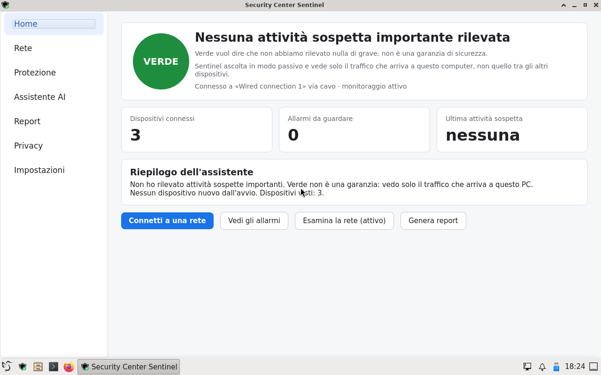
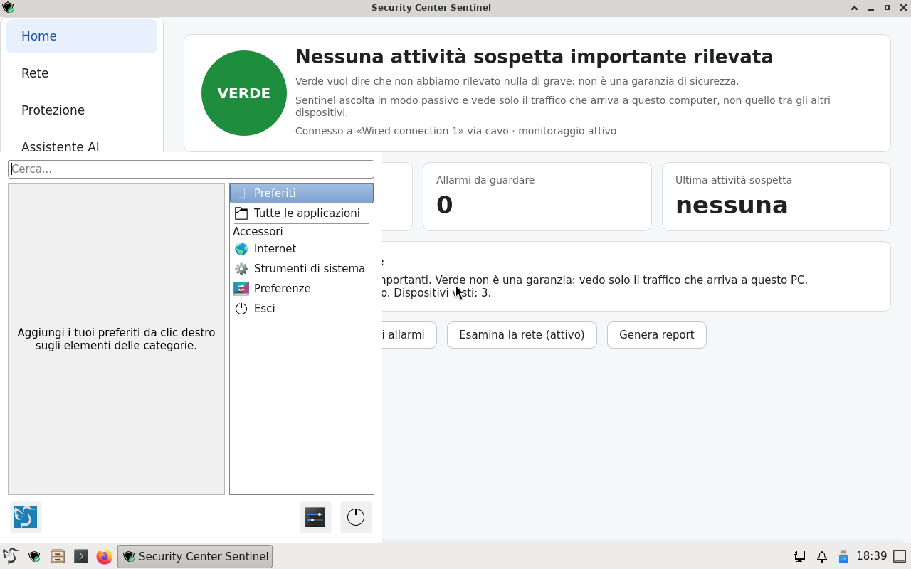
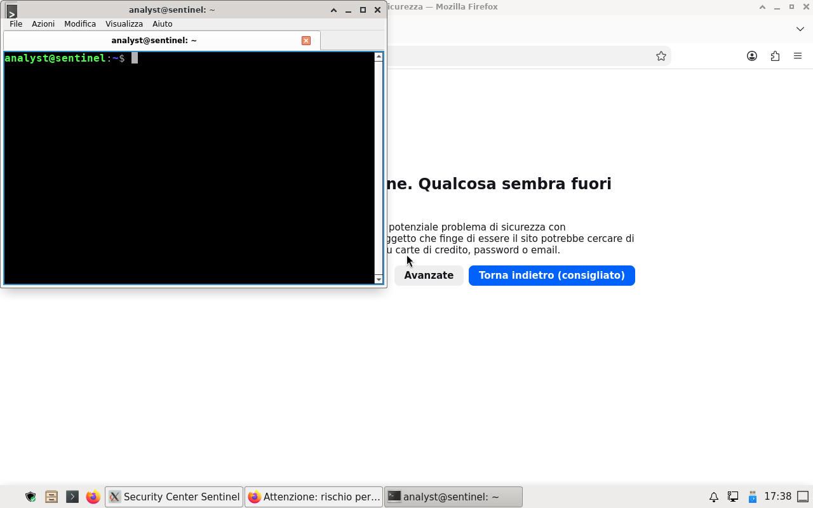
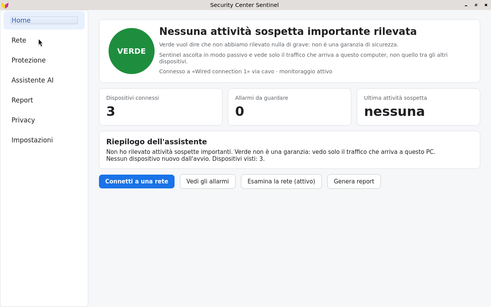
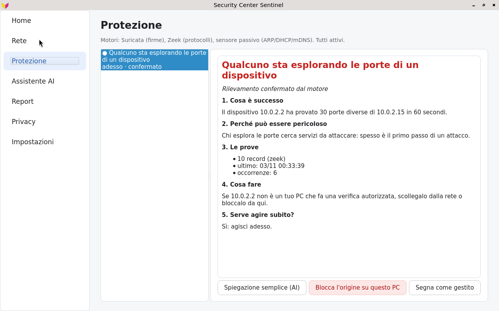

# CyberDistro Sentinel (Q3_K_M)

Edizione di CyberDistro dedicata al **monitoraggio passivo della rete** a cui il PC è collegato,
con un assistente AI che gira **in locale**. Si avvia da chiavetta USB senza installare nulla.
È un profilo di build separato (`editions/sentinel/`): la PC Edition (`build/`) e le sue release
non vengono toccate.

Studi di fattibilità: [v1](https://claude.ai/artifact/QLPXQ7jdxpCWkW1VwTiFN9) ·
[v2 — decisioni applicate qui](https://claude.ai/artifact/FzvjQ5WrDVaWmTgEbaSvHw).

## Due versioni: Kiosk e Lite

Sentinel esiste in due versioni. Il sistema di monitoraggio, l'assistente AI e il Security Center
sono **identici**; cambia solo ciò che vedi dopo l'avvio.

| | **Sentinel Kiosk** | **Sentinel Lite** |
| --- | --- | --- |
| All'avvio | solo il Security Center, a schermo intero | desktop LXQt con il Security Center aperto |
| Desktop | nessuno (sessione kiosk labwc, Wayland) | LXQt su Xorg, gestore finestre xfwm4, in italiano |
| Applicazioni in più | nessuna | file manager PCManFM-Qt, terminale QTerminal, editor FeatherPad, Firefox ESR, rete dalla barra (nm-tray) |
| Scegli questa se… | vuoi solo sapere se la tua rete è sicura, senza distrazioni | vuoi anche navigare, salvare i report dove vuoi, usare il terminale |
| Release (tag) | `sentinel-v*` | `sentinel-lite-v*` |
| File | `CyberDistro-Sentinel-Kiosk-Q3_K_M-x86_64.iso` (fino alla 0.1.1: `CyberDistro-Sentinel-Q3_K_M-x86_64.iso`) | `CyberDistro-Sentinel-Lite-Q3_K_M-x86_64.iso` |
| Limite di dimensione | < 2 000 000 000 byte | < 2 GiB (limite GitHub per file) |

Build: `./build.sh --flavour kiosk` (predefinito) oppure `./build.sh --flavour lite`. La versione
Lite è il profilo comune più la cartella `editions/sentinel/flavours/lite/` (pacchetti del desktop,
configurazione di LXQt, accesso automatico con `startx`).

### Sentinel Lite 0.1.0-alpha

ISO di 2 055 823 360 byte. Verificata in macchina virtuale come chiavetta USB in UEFI con Secure
Boot, UEFI e BIOS: desktop LXQt, Security Center con stato VERDE, menu, Firefox, file manager e
terminale funzionanti; ~1,46 GB di RAM usati con Security Center, Firefox e terminale aperti.
Dettagli: [`release/sentinel-lite-verification-0.1.0-alpha.md`](../../release/sentinel-lite-verification-0.1.0-alpha.md).
**Non ancora provata su hardware reale.**

| Desktop (UEFI, Secure Boot) | Menu | Firefox e terminale |
| --- | --- | --- |
|  |  |  |

## Stato della release 0.1.0-alpha (Kiosk)

Verificato in macchina virtuale (BIOS e UEFI): avvio fino all'interfaccia, motori attivi, stato
VERDE a riposo, port scan reale rilevato con stato ROSSO, RAM totale usata ~1,05 GB. L'assistente
AI della ISO funziona su CPU reale (25–48 s per spiegazione su 2 core). **Non ancora provato su
hardware reale.**

ISO pubblicata nella release [`sentinel-v0.1.0-alpha`](https://github.com/sciarmatissimo/cyberdistro/releases/tag/sentinel-v0.1.0-alpha)
(1 890 187 264 byte, SHA-256 `51368bba0ca8b010097799fdf366e1f88fb29e1c202fd044b68d192bfab41b77`, costruita da
GitHub Actions): scaricata e riprovata in QEMU (BIOS) il 3 novembre 2026 — avvio fino all'interfaccia,
stato VERDE a riposo, port scan dall'host rilevato con stato ROSSO. Dettagli: [`release/sentinel-verification-0.1.0-alpha.md`](../../release/sentinel-verification-0.1.0-alpha.md).

| Home in VM (UEFI) | Port scan rilevato in VM (BIOS) |
| --- | --- |
|  |  |

Requisiti: PC x86-64 con SSSE3 (Intel Core 2 / AMD Bulldozer o successivi), 4 GB di RAM per il
monitoraggio, 8 GB consigliati per l'assistente AI, chiavetta USB da 4 GB.

## Architettura

| Livello | Componenti | Dove nel repository |
| --- | --- | --- |
| 1. Rilevamento | Suricata 7 + regole ET Open ridotte; Zeek 9.0 core (log JSON); sensore passivo ARP/DHCP/mDNS/NDP | `editions/sentinel/rules/`, `sentinel/src/cyberdistro_sentinel/sensor.py`, `sentinel-engines` |
| 2. Correlazione | Normalizzazione, regole deterministiche, database SQLite, stato a 4 colori | `events.py`, `rules.py`, `store.py`, `status.py`, `daemon.py` |
| 3. Assistente | Schede scritte a mano it/en; Qwen3.5-2B Q3_K_M con llama.cpp; verificatore | `templates.py`, `assistant.py` |
| Interfaccia | Security Center Sentinel (PySide6): sessione kiosk labwc (Kiosk) o finestra nel desktop LXQt (Lite) | `gui/app.py`, `editions/sentinel/config/`, `editions/sentinel/flavours/lite/` |

Regole di sicurezza del livello 3: il modello non riceve mai stringhe arrivate dalla rete (nomi
DNS, nomi dei dispositivi, user-agent); riscrive solo fatti del livello 2; colore e urgenza non
vengono mai dal modello; una risposta con numeri, indirizzi, azioni "già fatte" o giudizi di
sicurezza non presenti nei fatti viene scartata e l'utente vede la scheda scritta a mano.

## Regole di correlazione (livello 2)

| Regola | Condizione | Affidabilità |
| --- | --- | --- |
| port_scan | ≥ 25 porte diverse di un host, senza risposta, in 60 s | confermato |
| host_sweep | ≥ 20 host sulla stessa porta in 60 s | confermato |
| brute_force | ≥ 10 connessioni con risposta a un servizio di login in 120 s | confermato |
| arp_spoof | un IP già associato a una scheda risponde con un'altra (gateway: alta) | confermato (gateway) / sospetto |
| suricata_alert | firma Suricata (gravità 1 alta, 2 media, 3 bassa) | confermato |
| dns_nxdomain_burst | ≥ 25 domini inesistenti da un host in 5 min | sospetto |
| dns_tunnel | ≥ 20 query con etichette ≥ 40 caratteri o TXT allo stesso dominio in 5 min | sospetto |
| beaconing | ≥ 6 connessioni verso lo stesso host esterno con intervallo regolare (CV ≤ 0,15, ≥ 10 s) | sospetto |
| exfiltration | ≥ 200 MB verso un host esterno in 10 min | sospetto |
| lateral_movement | un host interno verso ≥ 5 host interni su porte di amministrazione in 10 min | sospetto |
| new_device | dispositivo comparso dopo i primi 2 minuti | informativo |

Stato: **rosso** con almeno un evento confermato di gravità alta nell'ultima ora; **giallo** con
eventi di gravità media o alta; **verde** altrimenti (non è una garanzia); **grigio** se manca la
rete o un motore non è attivo.

## Limiti noti (alpha)

- Vede solo il traffico che arriva a questo PC: su una rete commutata non vede il traffico tra altri
  dispositivi (servirebbe un port mirror).
- Il traffico cifrato si analizza solo nei metadati.
- Le soglie sono state tarate solo su traffico sintetico: vanno verificate su reti reali (falsi positivi).
- L'assistente su 2 core impiega 20–60 secondi per risposta e richiede almeno 2,6 GB di RAM libera;
  su PC con 4 GB resta spento.
- Persistenza cifrata: script presente (`sudo cyberdistro-make-persistence`), non ancora provato
  su chiavetta reale in questa edizione.
- Fino alla 0.1.0 il caricatore UEFI non era firmato: con Secure Boot attivo il PC non riconosceva
  la chiavetta. Dalla 0.1.1 è firmato (shim + GRUB di Debian). Istruzioni per scrivere la chiavetta
  nelle note di rilascio.

## Build

```bash
docker run --rm --privileged -v "$PWD":/work -w /work/editions/sentinel debian:trixie bash -c '
  apt-get update && apt-get install -y --no-install-recommends live-build debootstrap xorriso \
    squashfs-tools mtools dosfstools grub-pc-bin grub-efi-amd64-bin python3 wget gnupg \
    ca-certificates cmake g++ git make binutils xz-utils && ./build.sh --flavour kiosk'   # oppure --flavour lite
```

Il build verifica: impronta della chiave OBS di Zeek, SHA-256 del modello (revisione Hugging Face
fissata), commit fissato di llama.cpp, caricamento delle regole Suricata (`suricata -T`), e fallisce
se la ISO non è sotto il limite della versione (Kiosk 2 000 000 000 byte, Lite 2 GiB). In GitHub
Actions: workflow **Build Sentinel ISO** (solo manuale, con la scelta `kiosk` o `lite`).

## Test

```bash
cd sentinel
PYTHONPATH=src python3 -m unittest discover -s tests -v          # correlazione, verificatore, sensore
QT_QPA_PLATFORM=offscreen PYTHONPATH=src python3 tests/gui_smoke.py shots/
```

Le fixture in `sentinel/tests/fixtures/` sono gli output reali di Suricata, Zeek e del sensore sul
pcap sintetico generato da `tests/make_synthetic_pcap.py` (sei scenari di attacco più traffico normale).
